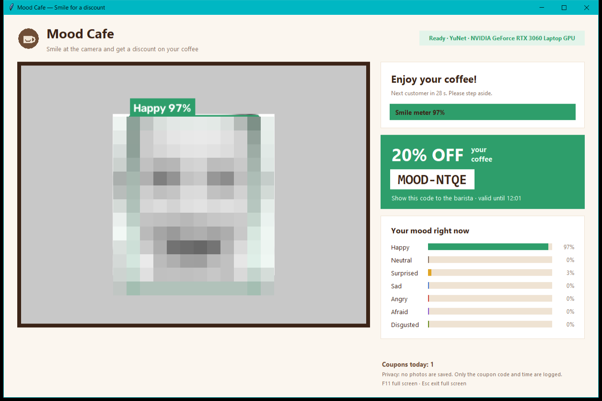
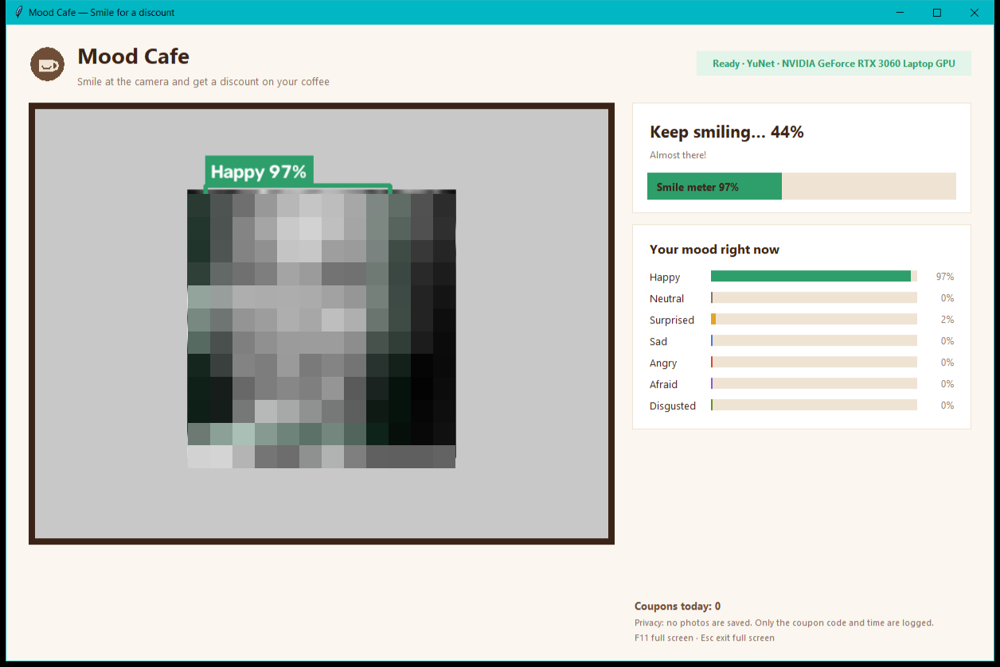

# Mood Cafe

**Smile at the coffee shop camera and get a discount on your coffee.**

Mood Cafe is a webcam kiosk for a coffee shop counter. It finds the customer's face with OpenCV,
reads their facial expression with a Vision Transformer on the GPU, and when they hold a real smile
for a moment it shows a one-time discount coupon to give to the barista.



*(Faces in the screenshots are pixelated test images.)*

## How it works

1. **Face detection**: OpenCV's YuNet deep-learning detector (falls back to the classic Haar
   cascade). This grew out of my first OpenCV face-detection script, kept in
   `examples/basic_face_detection.py`.
2. **Expression recognition**: a ViT model fine-tuned on FER-2013 gives probabilities for 7
   expressions: happy, neutral, surprised, sad, angry, afraid, disgusted.
3. **Smile to discount** (`moodcafe/discount.py`):
   - the happy score is smoothed over frames, so one lucky frame does not count;
   - the smile must stay above 80% for **1.5 seconds** (the smile meter fills up);
   - a bigger smile gives a bigger discount: **10%, 15% or 20%**;
   - after a coupon there is a 30-second pause, and the customer must step away before the next
     one, so the same person cannot repeat it;
   - coupons look like `MOOD-7KQ2`, are valid for 15 minutes and are logged to `coupons.csv`.



## Results

Measured with `scripts/evaluate.py` on all **3,589 faces** of the official FER-2013 test split
(full numbers in `docs/evaluation.json`):

| Measure | Result |
|---|---|
| Accuracy, 7 expressions | 71.7% |
| Accuracy for **happy** | **90.8%** |
| Smiles detected at the 80% threshold | 86.5% |
| Non-smiling faces wrongly counted as a smile | 1.4% |
| Precision of the smile signal | 95.1% |
| Speed (detection + expression) on RTX 3060 Laptop GPU | about 44 frames per second |

71.7% over 7 expressions is close to what is achievable on FER-2013 (low-resolution, noisy labels;
human accuracy is estimated at about 65%). The app only needs "happy", which is the most reliable
expression. Because the smile must also be held for 1.5 s, a single wrong frame cannot win a coupon.

## Setup (Windows)

1. Install Python 3.11+ (64-bit) and connect a webcam.
2. Double-click `INSTALL_WINDOWS.bat` (needs internet once). It installs the GPU build of PyTorch
   when an NVIDIA card is found (otherwise CPU) and downloads the face and expression models.
3. Double-click **`MoodCafe.exe`**. Press **F11** for full-screen kiosk mode, **Esc** to leave it.

Windows SmartScreen may warn once because the exe is not code-signed: **More info → Run anyway**.

Other ways to run:

```bat
.venv\Scripts\python.exe app.py                     & rem with the webcam
MoodCafe.exe --demo path\to\face_photos             & rem demo without a camera
.venv\Scripts\python.exe -m unittest discover -s tests -t .
.venv\Scripts\python.exe scripts\evaluate.py        & rem re-measure the model
```

## Project structure

```text
MoodCafe/
├── app.py                        # Kiosk window (Tkinter): camera, mood bars, smile meter, coupon
├── MoodCafe.exe                  # Double-click launcher
├── moodcafe/
│   ├── faces.py                  # YuNet / Haar face detection
│   ├── expression.py             # ViT expression classifier (GPU)
│   ├── discount.py               # Smile rules, tiers, cooldown, coupons
│   └── config.py
├── scripts/
│   ├── download_models.py        # One-time model download
│   └── evaluate.py               # FER-2013 test evaluation
├── tests/test_discount.py
├── examples/basic_face_detection.py
├── docs/                         # Screenshots and evaluation results
├── launcher/                     # Exe source, icon and build script
└── INSTALL_WINDOWS.bat
```

## Privacy and fairness

- **No photos or video are saved.** Frames are processed in memory; only the coupon code,
  discount and time are written to `coupons.csv`.
- Customers should know the camera is there: put a visible sign at the counter
  ("Smile at the camera for a discount").
- Expression models can work less well for some faces, lighting conditions, glasses or masks.
  Treat the discount as a fun promotion, and let staff give the discount by hand when needed.

## Limitations

- The expression model was fine-tuned on FER-2013 by its author; the model card mentions the full
  35,887-image dataset, so it may have seen the test faces. Real webcam accuracy can be lower than
  the table above.
- One discount per visit is enforced by the "step away" rule, not by recognising people (Mood Cafe
  deliberately does not identify anyone).
- Good, even lighting in front of the camera gives the best results.

## Credits and licenses

- Code: see `LICENSE` (MIT).
- Face detector: [YuNet](https://github.com/opencv/opencv_zoo/tree/main/models/face_detection_yunet)
  from the OpenCV model zoo (MIT).
- Expression model: [`abhilash88/face-emotion-detection`](https://huggingface.co/abhilash88/face-emotion-detection)
  (Apache-2.0), ViT fine-tuned on FER-2013.
- Evaluation data: FER-2013 test split via
  [`AutumnQiu/fer2013`](https://huggingface.co/datasets/AutumnQiu/fer2013).
